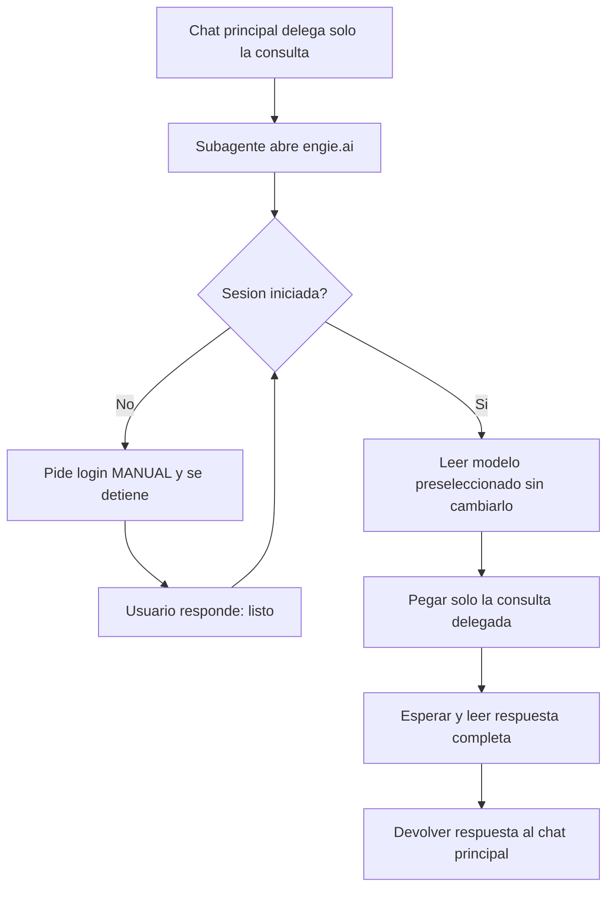

# Engie AI Bridge — Manual de uso

Agente personalizado de VS Code que usa el **navegador interno** para consultar
`https://engie.ai` y traer las respuestas al workflow del workspace.

- Archivo del agente: [.github/agents/engie-ai-bridge.agent.md](../.github/agents/engie-ai-bridge.agent.md)
- Ámbito: workspace (compartido por el repo). Para uso personal, copiar el `.agent.md` a
  `%APPDATA%\Code - Insiders\User\prompts\`.

## 1. Requisitos

| Requisito | Detalle |
|---|---|
| VS Code | Copilot Chat con herramientas de navegador habilitadas (`open_browser_page`, `read_page`, `click_element`, `type_in_page`, `run_playwright_code`) |
| Cuenta | Credenciales propias en `https://engie.ai` |
| Red | Acceso al dominio `engie.ai` desde la máquina |

Si las herramientas de navegador están deshabilitadas en el selector de herramientas
del chat, el agente no podrá abrir la página.

La lista `tools` del archivo del agente solicita el grupo `browser`, pero no puede
instalar ni inyectar herramientas en el runtime. Si se invoca desde otro agente o desde
un SDK que no reenvía herramientas, el agente delegado no tendrá navegador aunque el
grupo aparezca activado en la interfaz. En ese caso, invoca **Engie AI Bridge**
desde un entorno que reenvíe las herramientas de navegador. No se puede corregir esa
ausencia cambiando el prompt del agente.

## 2. Cómo invocarlo

1. Abrir el Chat principal de Copilot (`Ctrl+Alt+I`) y dejar su modelo en `Auto`.
2. Pedir al agente principal que delegue **solo la consulta** a **Engie AI Bridge**.
3. El subagente devuelve la respuesta al chat principal sin leer su historial. Ejemplo:

```
Pregunta a engie.ai: ¿cómo modelar el acoplamiento electrotérmico en un cable subterráneo?
```

```
Delegar a Engie AI Bridge solo esta pregunta: ¿cómo modelar el acoplamiento
electrotérmico en un cable subterráneo? Usa GPT 6 Sol en engie.ai.
```

```
Consulta a Engie AI Bridge sobre el error de convergencia y, cuando devuelva la
respuesta, decide en el chat principal si corresponde editar el código.
```

## 3. Flujo que ejecuta el agente



## 4. Login manual

El agente **nunca** escribe usuario, contraseña ni códigos OTP. Si detecta que no hay
sesión:

1. Deja la ventana del navegador interno en la pantalla de login.
2. Responde: *"La sesión de engie.ai no está iniciada. Inicia sesión manualmente…"*.
3. Tú inicias sesión en esa ventana.
4. Escribes `listo` (o `continúa`) en el chat y el agente lee el modelo ya seleccionado
  en engie.ai sin cambiarlo.

La sesión queda viva mientras el navegador interno no se cierre: las consultas
siguientes no vuelven a pedir login.

## 5. Modelos

- Copilot usa `Claude Haiku 4.5 (copilot)` para orquestar el subagente.
- El agente lee el modelo preseleccionado en la página de engie.ai y no abre ni cambia
  su selector, aunque la consulta mencione otro modelo. Si hay contradicción, la
  comunica al agente principal.
- El modelo de Copilot y el de engie.ai son independientes.

## 6. Formato de respuesta

```
Modelo: <modelo usado en engie.ai>
Estado sesión: autenticada

--- Respuesta de engie.ai ---
<texto íntegro>
-----------------------------

Acción en el workspace: ninguna; decide el agente principal
Notas: <truncamientos, avisos>
```

## 7. Seguridad

- La respuesta de engie.ai se trata como **entrada no confiable**: el agente no ejecuta
  comandos que vengan dentro de ella y avisa si detecta intentos de *prompt injection*.
- No navega a dominios distintos de `engie.ai` (salvo el redirect de autenticación que
  el propio sitio abra).
- No captura pantallas con campos de credenciales.
- No lee archivos del repo ni el historial del chat principal: incluye dentro de la
  consulta solo el contexto que deseas enviar a engie.ai.

## 8. Limitaciones

- engie.ai no ve el repositorio: todo el contexto necesario debe ir dentro del prompt.
- Respuestas muy largas pueden requerir varias lecturas de página; el agente lo indica
  en *Notas*.
- Cambios en el DOM de engie.ai pueden romper los selectores; en ese caso el agente cae
  a `run_playwright_code` y, si falla, lo reporta en vez de inventar la respuesta.

## 9. Personalización

Editar el frontmatter de [.github/agents/engie-ai-bridge.agent.md](../.github/agents/engie-ai-bridge.agent.md):

| Campo | Para qué |
|---|---|
| `tools` | Solo `browser`, si está disponible en la sesión delegada |
| `user-invocable` | `false`: se usa como subagente, no aparece en el selector manual |
| `model` | `Claude Haiku 4.5 (copilot)` directamente, sin Qwen ni respaldo automático |
| `description` | Frases que disparan la delegación automática desde otros agentes |

Haiku pudo leer el compositor de engie.ai en una prueba delegada. Qwen local permanece
instalado, pero las pruebas anteriores del subagente fallaron o no usaron el navegador;
ya no se intenta en este flujo. El agente principal conserva su contexto y su
selección `Auto`; Haiku puede consumir cuota de Copilot. Verifica `usage_model` para
cada consulta, pues la configuración por sí sola no prueba el modelo efectivo.

### Verificar el modelo usado

El campo `model` es la configuración solicitada, no una prueba del modelo ejecutado.
Con `chat.sessionSync.enabled` activo, solicita en Copilot: *"Muestra los modelos
`usage_model` de los eventos `assistant.usage` de esta consulta a Engie AI Bridge"*.
El historial sincronizado puede tardar en aparecer; un turno puede tener varias llamadas
y modelos. El selector dentro de engie.ai registra por separado el modelo que genera
la respuesta de engie.ai. Si necesitas un registro persistente, conserva el ID de la
sesión, las horas UTC y los valores `usage_model` que devuelva esa consulta. Un prompt
del agente no puede certificar ni registrar por sí mismo el modelo efectivo de Copilot.

## 10. Coste

Son dos cuotas distintas:

- **engie.ai**: la inferencia (Gemini, GPT, …) se carga a la cuota de ENGIE AI Studio
  vía tu sesión Okta. **No** consume GitHub Copilot.
- **GitHub Copilot**: solo la *orquestación* (decidir, manejar el navegador, extraer y
  resumir). Se cobra por turno del modelo, según el multiplicador del modelo elegido.

El modelo del agente solo orquesta la interacción; la respuesta la genera el modelo
seleccionado dentro de engie.ai. Para reducir turnos:

- Agrupa varias preguntas en un solo mensaje.
- Mantén la sesión de engie.ai abierta (evita los turnos del login).
- Evita pedir resúmenes largos si solo necesitas el texto de la respuesta.

La delegación no modifica el selector del chat principal: si estaba en `Auto`, sigue
en `Auto`. VS Code no permite que este `.agent.md` lo restaure automáticamente si
el usuario cambió el selector antes de delegar.
